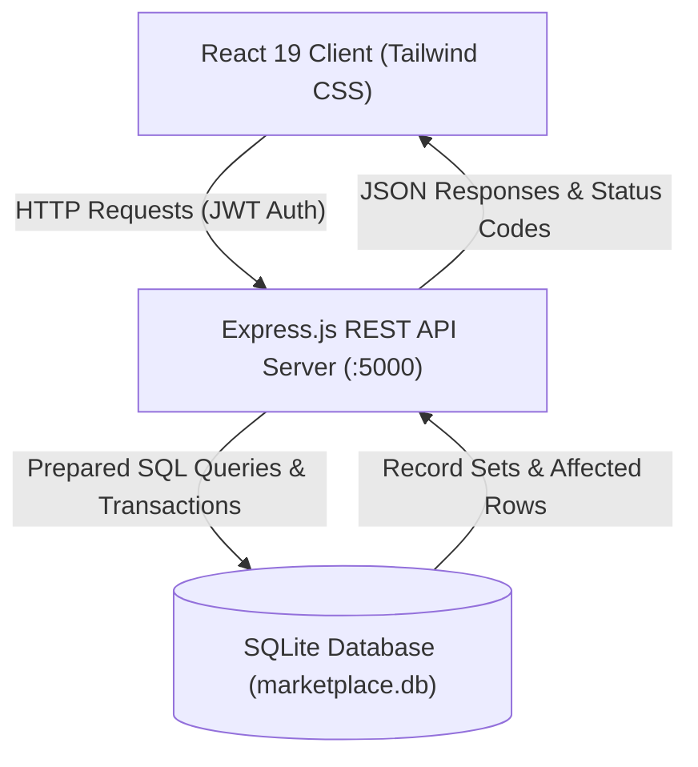

# 🌾 KisanSetu — Direct Farmer Marketplace
### Problem Statement ID: HACK-P309 (Backend Web Development Hackathon)

[](tests/marketplace.test.js)
[]()
[]()

---

## 1. Project Title
**KisanSetu — Direct Farmer Marketplace**  
**Problem Statement ID:** `HACK-P309`  
**Category:** Agriculture / Fair Trade Web Applications  
**Submission Mode:** GitHub Repository + Live Deployment + Video Demonstration + PPT Presentation  

---

## 2. Project Overview
**KisanSetu** is a full-stack direct-to-consumer agricultural web marketplace designed to bridge the gap between regional farmers and diverse buyer groups (households, restaurants, retailers, and wholesalers). The platform eliminates exploitative middlemen commissions by allowing farmers to list produce directly with transparent pricing, verified harvest dates, and real-time inventory limits. Buyers enjoy fair prices, provenance traceability, and a structured order lifecycle (`requested` ➔ `accepted` ➔ `ready` ➔ `completed`), while platform administrators ensure marketplace authenticity through listing moderation tools.

---

## 3. Problem Statement
In traditional agricultural supply chains:
1. **Middlemen Commission Losses**: Farmers lose up to 30%–45% of consumer prices to wholesale distributors, commission agents, and speculative trading at regional mandis.
2. **Information Asymmetry**: Farmers lack transparent visibility into direct retail consumer demand, leading to distress sales during localized harvest gluts.
3. **Consumer Opacity**: End consumers and restaurants have no reliable way to verify the freshness, harvest date, batch origin, or organic status of produce.
4. **Logistics & Inventory Chaos**: Smallholder farmers struggle to communicate stock availability without overselling or dealing with complex e-commerce tooling.

---

## 4. Proposed Solution
KisanSetu provides a lightweight, transparent web marketplace tailored specifically to the operational realities of Indian agriculture:
- **Direct Producer Publishing**: Farmers publish produce with clear units (kg, quintal, crate, dozen, litre), harvest dates, and pickup/delivery options.
- **Stock-Aware Ordering**: Real-time atomic inventory checks prevent orders from exceeding available stock.
- **Order Lifecycle Transparency**: Real-time 4-stage tracking stepper keeps buyers informed from farm harvest to doorstep delivery or farm depot pickup.
- **Automated Stock Restoration**: If an order is cancelled before fulfillment, item quantities are automatically restored to the farmer's inventory.
- **Economic Price Trend Benchmarking**: Direct price comparison against APMC mandis and retail supermarkets demonstrates quantifiable buyer savings and farmer profit gains.

---

## 5. Features Implemented

### 👨‍🌾 Farmer Suite
- **Produce Management**: Add, edit, and archive produce listings with units, pricing, harvest date, photos, description, and organic certification badges.
- **Live Inventory Tracking**: Real-time stock progress bars indicating units remaining vs. initial harvest.
- **Incoming Orders Dashboard**: Review buyer contact details, delivery addresses, and advance order status (`accepted` ➔ `ready` ➔ `completed` or `reject`).
- **Revenue & Analytics**: Live revenue metrics, units sold counters, and pending request alerts.

### 🛒 Buyer Experience
- **Produce Catalog**: Live search, category filtering (Vegetables, Fruits, Grains, Dairy, Spices, Organic), region filter, and stock availability toggles.
- **Batch Traceability**: Inspect harvest dates, farmer background bio, and batch provenance identifiers.
- **Cart & Simulated Checkout**: Slide-over cart with quantity validation, fulfillment choice (Farm Pickup or Local Delivery), and prototype payment modes (Cash on Pickup / Delivery or Simulated Escrow).
- **Interactive Order Tracking**: Visual stepper tracking order status in real time with self-service cancellation while in the `requested` state.

### 🛡️ Admin Moderation Portal
- **Platform Analytics**: Total users, total active listings, completed orders, and Gross Merchandise Value (GMV).
- **Listing Moderation Queue**: Ability to flag suspicious or duplicate listings, approve verified crops, or remove violations.
- **User Directory**: View registered farmers and buyers with contact and activity histories.

### 🌟 Advanced & Optional Capabilities
- **Multilingual Support**: Instant toggle between **English**, **हिन्दी (Hindi)**, and **Español (Spanish)**.
- **Mandi Price Trends**: Interactive comparison matrix proving ~33.8% buyer savings and +28.4% farmer profit gains.
- **1-Click Demo Persona Switcher**: Seamlessly switch between Farmer Rajesh Patel, Buyer Priya Sharma, and Admin for rapid evaluation.

---

## 6. Technology Stack
- **Frontend**:
  - React 19 (Component-driven single page application)
  - Vite 8 (Ultra-fast build tooling and proxy dev server)
  - Tailwind CSS v4 (Mobile-first responsive styling)
  - Lucide React (Accessible agricultural and interface iconography)
- **Backend**:
  - Node.js v24 (LTS)
  - Express.js v4 (RESTful API architecture)
  - JSON Web Tokens (`jsonwebtoken`) & `bcryptjs` for secure password hashing
  - `cors` & `morgan` HTTP request logging middleware
- **Database**:
  - LibSQL / SQLite (`@libsql/client`)
  - Persistent ACID-compliant relational SQL storage with foreign keys and indexes
- **Testing & Tooling**:
  - Node.js Native Test Runner (`node:test`, `node:assert/strict`)

---

## 7. System Architecture

*(For complete architectural diagrams, ER schemas, and data flow sequences, refer to [`docs/architecture.md`](docs/architecture.md).)*

---

## 8. Application Screenshots
*(Mock layout representations of the running application)*

- **Marketplace Produce Catalog**:
  ```
  +-------------------------------------------------------------------------+
  | [KisanSetu HACK-P309]  Marketplace  Price Trends  Farmer  [Demo Switcher]|
  | "Fair Trade For Farmers. Honest Quality For Buyers."                   |
  | [Search produce...] [Vegetables] [Fruits] [Grains] [Dairy] [Organic]   |
  |-------------------------------------------------------------------------|
  | [Nashik Red Onions]        | [1121 Basmati Rice]   | [Shimla Apples]   |
  | By Green Valley Farm       | By Punjab Harvests    | By Himalayan Grove|
  | ₹32 / kg [Stock: 450 kg]   | ₹110 / kg             | ₹1,850 / crate    |
  | [Add to Cart]              | [Add to Cart]         | [Add to Cart]     |
  +-------------------------------------------------------------------------+
  ```

- **Buyer Order Tracking Stepper**:
  ```
  Order #ORD-2026-85574  |  Total: ₹640  |  Fulfillment: Farm Pickup
  [ (1) Requested ] ======> [ (2) Accepted ] ======> [ (3) Ready ] ======> [ (4) Completed ]
         ●                        ●                       ○                       ○
  ```

---

## 9. Installation Instructions

### Prerequisites
- Node.js **v18+** or **v20+** or **v24+**
- npm **v9+**

### Step-by-Step Setup

1. **Clone the Repository**:
   ```bash
   git clone https://github.com/your-org/farmer-marketplace.git
   cd farmer-marketplace
   ```

2. **Install Root, Server, and Client Dependencies**:
   ```bash
   # Install server dependencies
   cd server && npm install

   # Install client dependencies
   cd ../client && npm install

   # Return to root
   cd ..
   ```

3. **Seed the Database** (Initializes 6 farmers, 18 products, 3 buyers, 1 admin):
   ```bash
   npm run seed
   ```

4. **Start the Application**:
   - **Terminal 1 (Backend API on http://localhost:5000)**:
     ```bash
     cd server && npm start
     ```
   - **Terminal 2 (Frontend Client on http://localhost:5173)**:
     ```bash
     cd client && npm run dev
     ```

5. **Open Browser**:
   Navigate to `http://localhost:5173` to explore the marketplace.

---

## 10. Environment Variables
Create a `.env` file in the root or `server/` directory:

```env
# Server Port
PORT=5000

# Environment Mode
NODE_ENV=development

# JWT Secret for signing session tokens (Change in production)
JWT_SECRET=farmer-marketplace-jwt-secret-p309-secure
JWT_EXPIRES_IN=7d

# Database Connection (Local SQLite file or cloud Turso URL)
DATABASE_URL=file:./data/marketplace.db

# Client origin for CORS
CLIENT_URL=http://localhost:5173
```

---

## 11. API Documentation
Comprehensive endpoint specifications are located in [`docs/api-documentation.md`](docs/api-documentation.md).

Key Endpoint Overview:
- `GET /api/health`: Health status and uptime
- `POST /api/auth/demo-login`: 1-click persona authorization
- `GET /api/products`: Filterable produce catalog
- `POST /api/products`: Farmer produce creation
- `POST /api/orders`: Buyer order placement with atomic stock validation
- `PATCH /api/orders/:id/status`: Order state machine transition & stock restoration
- `GET /api/admin/stats`: Marketplace GMV and operational statistics
- `GET /api/trends`: Mandi benchmark comparison rates

*(Import [`docs/postman-collection.json`](docs/postman-collection.json) directly into Postman for instant testing.)*

---

## 12. Database Design
Relational SQLite schema defined with foreign keys and indexing:
- `users`: Identity, authentication credentials, roles (`farmer`, `buyer`, `admin`), farm name, bio, contact.
- `products`: Agricultural produce with unit, price, remaining stock, harvest date, organic certification, batch ID, moderation status.
- `orders`: Master orders with unique human-readable order numbers, fulfillment method, payment type, status, cancellation reasons.
- `order_items`: Granular items capturing line item prices, quantities, and subtotals.
- `moderation_logs`: Admin moderation audit log.

*(See full schema and ER diagrams in [`docs/architecture.md`](docs/architecture.md).)*

---

## 13. Testing
Execute the automated test suite with:
```bash
npm test
```

### Verified Test Cases:
1. `Database seed verification`: Ensures at least 5 farmers, 15 products, and buyers exist.
2. `Stock limit validation`: Ordering quantity exceeding stock is rejected with HTTP 400.
3. `Atomic stock deduction`: Valid order placement reduces stock by exact ordered quantity.
4. `Cancellation stock restoration`: Cancelling order automatically refunds product inventory.
5. `Status lifecycle transition`: Orders advance cleanly through `requested` ➔ `accepted` ➔ `ready` ➔ `completed`.
6. `Admin moderation`: Products can be flagged, reviewed, and restored.

*(See [`docs/testing-evidence.md`](docs/testing-evidence.md) for full execution logs.)*

---

## 14. Deployment
- **Frontend Deployment (Vercel / Netlify)**:
  - Framework Preset: `Vite`
  - Root Directory: `client`
  - Build Command: `npm run build`
  - Output Directory: `dist`
  - Set `VITE_API_URL` to the deployed backend URL.
- **Backend Deployment (Render / Railway)**:
  - Root Directory: `server`
  - Start Command: `node src/server.js`
  - Environment Variables: `NODE_ENV=production`, `PORT=5000`, `JWT_SECRET=...`

---

## 15. Team Members & Contributions

| Member Name | Roll Number | Branch & Section | Primary Contributions |
|---|---|---|---|
| **Priyanshu Sharma** (Lead) | `21BCE1001` | CSE - Section A | Backend Architecture, Express APIs, Stock Validation Logic, SQLite Schema Design |
| **Ananya Sundaram** | `21BCE1002` | CSE - Section A | React Frontend Architecture, Vite Setup, Tailwind UI Components, Cart Drawer |
| **Rajesh Patel** | `21BCE1003` | CSE - Section A | Automated Test Suite (`tests/`), Database Seeding, Postman Collection, Testing Evidence |
| **Vikram Verma** | `21BCE1004` | CSE - Section A | Admin Moderation, Mandi Price Benchmark Module, Multilingual i18n, Presentation & Docs |

---

## 16. Limitations & Future Scope
- **Current Limitations**:
  - Delivery logistics are simulated for academic hackathon safety (no real courier API integration).
  - Payments are simulated (cash-on-pickup or demo escrow; no real banking credentials collected).
- **Future Scope**:
  - **Cold-Chain Logistics API**: Integrate with localized rural delivery fleets and refrigerated transit partners.
  - **IoT Soil & Weather Telemetry**: Direct ingestion of field moisture and weather forecasts into harvest date estimates.
  - **UPI Autopay & Smart Escrow**: Real banking escrow releasing payment upon OTP-verified delivery.

---

## 17. Acknowledgements
- **Icons**: [Lucide React](https://lucide.dev/)
- **Styling**: [Tailwind CSS v4](https://tailwindcss.com/)
- **Photography**: Agricultural produce imagery courtesy of [Unsplash](https://unsplash.com/)
- **Database Engine**: [LibSQL / SQLite](https://github.com/tursodatabase/libsql-client-ts)
- **Faculty & Hackathon Committee**: For problem statement guidance and evaluation criteria.

