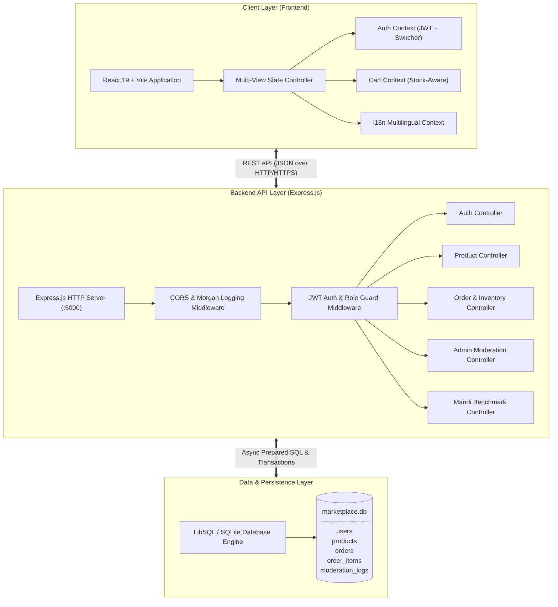
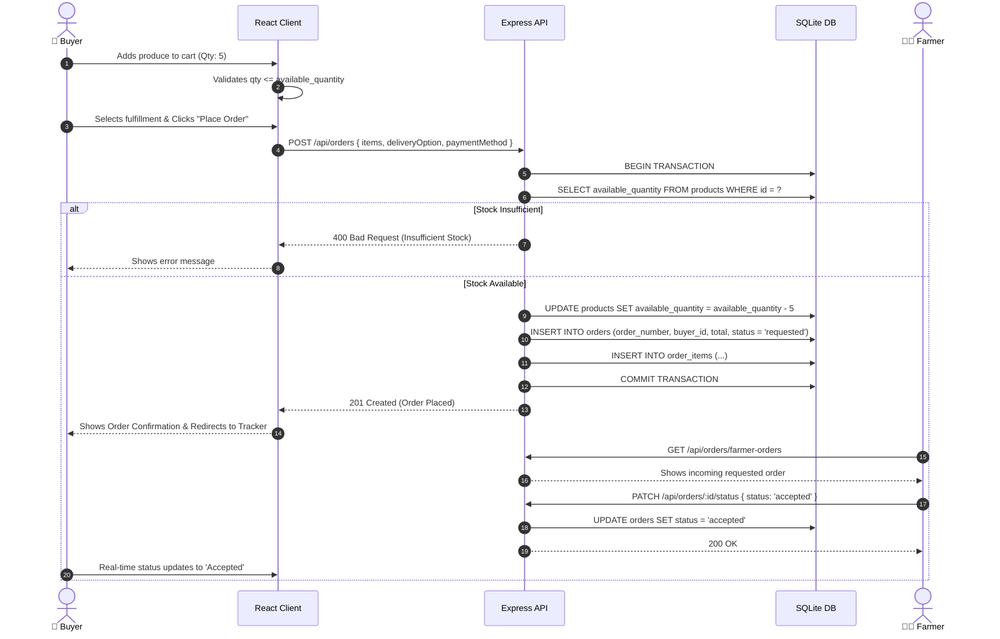
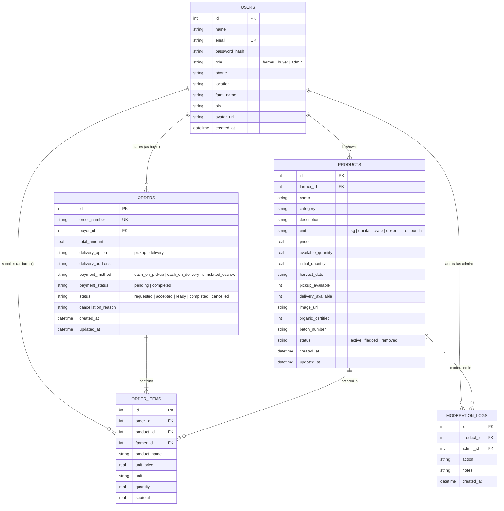

# 🏗️ System Architecture & Database Design — HACK-P309

## 1. System Architecture Diagram

---

## 2. End-to-End Order & Stock Deduction Data Flow

---

## 3. Entity-Relationship (ER) Diagram

---

## 4. Key Architectural Safeguards

1. **Atomic Inventory Control**:
   - Stock deduction occurs within transactional database logic.
   - If stock is insufficient for any item in a multi-item order, the entire request aborts cleanly without partial deductions.

2. **Automated Stock Restoration on Cancellation**:
   - When an order transitions to `cancelled`, every product item's quantity is returned to the farmer's inventory.

3. **Role-Based Access Control (RBAC)**:
   - Buyers cannot create produce listings or alter other orders.
   - Farmers can only edit their own listings and progress status of orders containing their produce.
   - Administrators have moderation privileges to flag, approve, or remove fraudulent listings.

4. **Prototype Safety & Security**:
   - Zero storage of real credit cards or bank details.
   - Realistic simulated escrow & cash-on-pickup payment workflows.
   - Passwords protected via salted bcrypt hashes.
   - Stateless JWT tokens for authentication.

